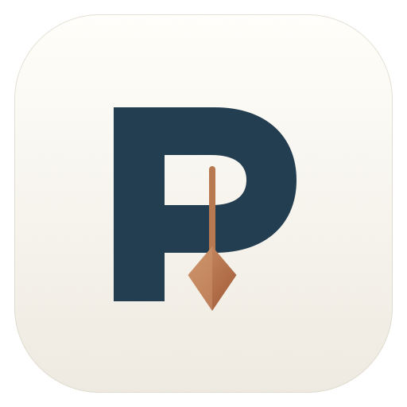

<p align="center"></p>

# Prumo

A native Mac library for the work you did with Codex and Claude Code.

Prumo searches local sessions, finds source passages, generates optional cited answers through your existing Codex CLI, manages skills, and resumes sessions in their original agent. It has no app account, login screen, billing, or subscription flow.

[Download the Apple Silicon preview](https://github.com/leonardocouy/prumo/releases) · [Build from source](BUILDING.md) · [Privacy](PRIVACY.md)


## Use the app

Open `dist/Prumo.app`, or the installed copy in `~/Applications/Prumo.app`.

1. Open Settings → Folders. Choose the data folders for Codex and Claude Code.
2. Let the library refresh. Search by title, session ID, or conversation text.
3. Open a result to read the conversation. Matching results jump to their source message.
4. Choose Continue to resume that session in Terminal with its original agent and data root.

The Claude folder must contain `projects`. A custom root such as `~/.claude-work` works. The Codex folder must contain `sessions` and optionally `archived_sessions`.

The first launch uses `CODEX_HOME` and `CLAUDE_CONFIG_DIR` when supplied. Otherwise, it uses `~/.codex` and `~/.claude`. On a Mac with `~/.claude-work`, it prefers that Claude profile. Both paths remain editable.

## Interface

Version 0.3.0 uses a light native interface with a compact sidebar and consistent text and spacing.

- Sessions use a compact results column beside the conversation. Filters and ordering stay with the search.
- Skills use a table with agent access, recorded uses, and approximate added dates. Select a row to open its detail panel. Checkboxes select bulk actions.
- Answers use a reading column with source passages on the right.
- Settings opens in its own native window with **Command–comma**. Invalid folder paths show a recovery message. Cancel discards draft changes.

Prumo uses ink blue, warm white, and copper, with a plumb-line mark. See [the identity source](Brand/README.md).

## Cited answers

Open **Ask your history**, enter a question, and choose **Find passages**. This runs locally. Review the source panel and deselect passages you do not want to include.

Choose **Answer with Codex** to send the question and selected excerpts through your existing Codex CLI. Prumo does not store an API key or run its own authentication flow. The CLI must already work in your terminal.

The answer uses structured statements with numbered citations. Citation numbers are validated before display. Opening a citation resolves a fingerprint of the source message. Appended messages preserve existing anchors. Changed or removed source text produces a refresh notice.

You can read and open local passages without using a model. Generated answers describe historical sessions. They do not verify the current project.

## Skills

Prumo reads:

- The shared skills folder, normally `~/.agents/skills`.
- `<Codex data folder>/skills`.
- `<Claude data folder>/skills`.
- Any additional skill folders selected in Settings.

Select a skill to read its Markdown and supporting file list. Use Edit to change `SKILL.md`. External edits are detected before saving. New skills can be created in a configured root.

Link and Unlink manage symbolic links in an agent's skill directory. Existing original folders and conflicting names are never replaced. Shared Codex skills and original folders show their source status instead of an unlink control.

Use the checkboxes to select several skills, or choose **Select visible** for the current search and filter. Selection remains when the filter changes. **Clear selection** clears all selected skills, including hidden ones. Open **Actions** to link, unlink, or move selected skills to Trash. The review panel lists every affected skill and its path before applying changes. Ineligible items are counted separately.

Move to Trash moves the complete editable skill folder to macOS Trash. Matching direct symlinks in the configured Codex, Claude, and shared skill roots are removed after the folder moves. Restore a folder through Trash, then relink it if needed. Managed plugin content and skills outside editable roots remain read-only. Folders containing other installed skills cannot be trashed as a parent. Remove their child skills separately.

Removal checks the document revision and matching links again after review. Changed items are left in place. A failed operation leaves that item selected and reports its error. Other eligible items can still complete. If link cleanup fails after a folder moves, the app reports the remaining link.

### Added dates

Skill rows and details show **Added ≈** using the original skill folder’s filesystem creation date. Sort with **Newest added** or **Oldest added**. Skills without this metadata show **Added date unavailable** and sort last.

This is an estimate of when the folder was added, not a verified installation log. Copies, migrations, and restores can change or preserve creation dates. Editing `SKILL.md` or adding an agent link does not reset the source folder’s date. No modification-time fallback or separate date registry is used.

### Recorded usage

Each skill shows its recorded uses. The detail panel shows totals for Codex and Claude Code, the last recorded use, and links to the indexed source sessions. Filter by **Recorded use** or **No recorded use**. Sort by name, most used, or last used.

A use is a successful recorded skill call or a `SKILL.md` read. Reads can include inspection or editing preparation. They do not prove that an agent followed the instructions. Mere mentions in messages, skill catalogs, searches, and writes are not counted.

Supported evidence:

- Codex completed `CommandExecution` events with successful exit status and parsed file-read paths.
- Older Codex direct shell tool calls with a successful result, when completed command events are absent.
- Claude Code `Skill`, `Read`, and literal shell-read calls with successful tool results.

Legacy shell detection accepts single literal `cat`, `head`, `tail`, and non-in-place `sed` commands. Compound commands and dynamic scripts are excluded because an overall success can hide a failed read. Duplicate event IDs, copied fork history, and symlink aliases do not multiply one recorded event for one skill. Distinct reads remain distinct uses. Skill names must resolve uniquely; ambiguous names are excluded. Namespaced Claude calls can resolve against a matching plugin directory.

**No recorded use does not mean never used.** Counts cover the indexed main sessions under the configured agent roots. Missing or deleted history, subagent-only activity, unsupported formats, and moved or removed skill paths can leave gaps. Counts refresh from source records. They are not a separate lifetime counter. The first launch after this update rebuilds the derived session cache.

## Build

Requirements: Apple Silicon Mac, macOS 15 or later, Rustup, and Apple's Swift Command Line Tools.
The repository selects Rust 1.99.1. Cargo uses the dependencies pinned in `core/Cargo.lock`.

```sh
cargo install cargo-about --version 0.9.2 --locked --features cli
bash scripts/build.sh
open dist/Prumo.app
```

The build compiles Rust, generates UniFFI bindings, compiles the SwiftUI/AppKit app, and creates an ad hoc signed bundle. The Rust library is linked statically. No separate runtime library is required in the app bundle.

Intel Macs are not supported. See [BUILDING.md](BUILDING.md) for tests, ZIP and DMG packaging, and GitHub Actions.
Downloaded previews are not notarized by Apple. Gatekeeper can block them. Building from source is an alternative.

Regenerate the original app icon when needed:

```sh
swift scripts/make-icon.swift scripts
iconutil -c icns scripts/Prumo.iconset -o scripts/Prumo.icns
```

## Verify

Run:

```sh
bash scripts/test.sh
```

This rebuilds the app and bindings, then runs Rust behavior tests, Clippy, a Swift build, and native Swift behavior checks. The native checks compile the production service files directly. They work with Command Line Tools and do not require the full Xcode test runner.

Tests also cover skill usage deduplication, failed reads, ambiguous names, source refresh, protected Trash plans, partial bulk failures, stale reviews, and changed-link protection.

Tests cover malformed and incomplete records, custom profiles, Codex event formats and inherited fork metadata, activity timestamps, search boundaries, source pruning, citation stability, stale skill edits, unsafe paths, link collisions, continuation quoting, process cancellation/deadlines, and a complete answer subprocess roundtrip with a mock CLI.

## Data and limits

The local cache lives in `~/Library/Application Support/Prumo/Library.sqlite`. It contains searchable conversation text. Original session files remain the source of truth. Refresh reads them without changing them. Settings use UserDefaults.

Session parsing includes user and assistant text. Tool output, encrypted reasoning, and generated instruction scaffolding are excluded from searchable conversation text. Supported skill tool events supply a separate derived usage index. Empty or unsupported files are skipped. Safety limits are 512 MB per session file, 8 MB per JSONL record, and 500,000 characters per stored message. Skills are limited to a 2 MB `SKILL.md` document. Source notices show parse or access failures.

Search uses SQLite FTS5 with literal token prefixes. Session results default to **Newest activity**, based on each session’s last recorded activity. Use **Order** to choose **Oldest activity** or **Relevance**. Relevance uses the best matching message in each session, then recent activity and session ID to break ties. Without a text match, relevance falls back to newest activity.

Title, session ID, and conversation matches share one ordered list. Sessions are deduplicated and sorted before the 300-result display limit. Repeated matches within one conversation cannot crowd other matching sessions out of the search. Each text result still shows its best matching passage, and opening the result jumps to that message. Date ties use a stable session ID order.

Natural-language evidence retrieval uses relevance, keywords, and adjacent messages regardless of the session list’s order. It is not a vector index. Narrow the search or project filter when more than 300 sessions match.

Continuation resumes in the original agent. It does not convert sessions between agents. Sharing, remote machines, automatic recall hooks, billing, and cloud synchronization are outside this release.

Read [PRIVACY.md](PRIVACY.md) for storage and network behavior, [CONTRIBUTING.md](CONTRIBUTING.md) to contribute, and [SECURITY.md](SECURITY.md) to report a security issue.

Prumo is open source under the [MIT license](LICENSE). Third-party components retain their own licenses.
Builds include a generated dependency license report with package versions and source links.
